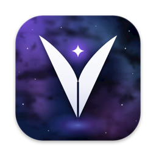
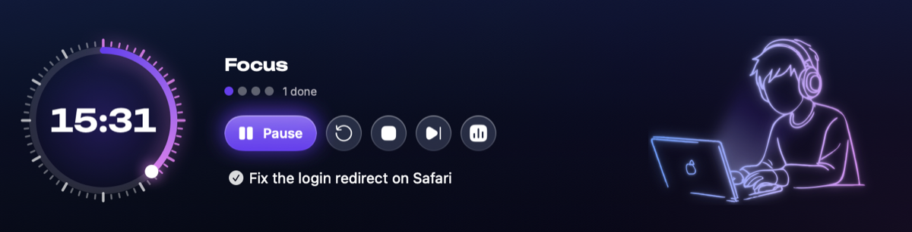
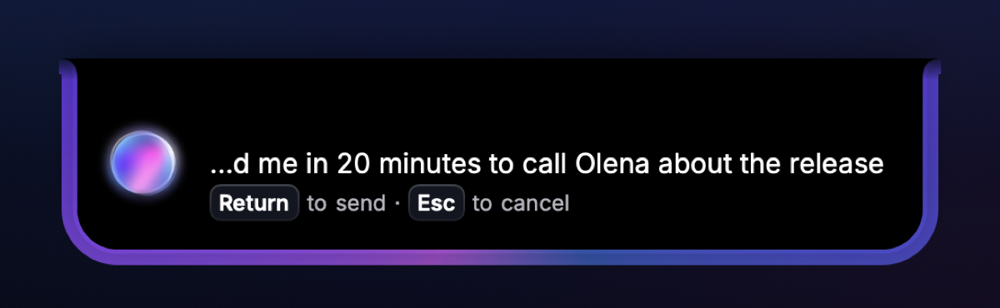
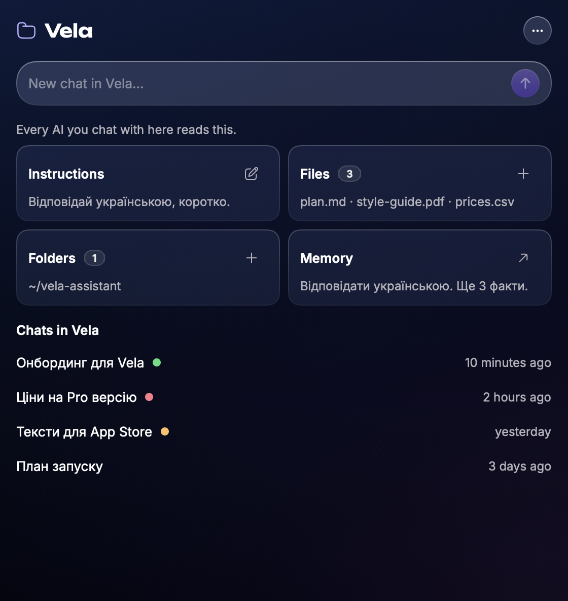
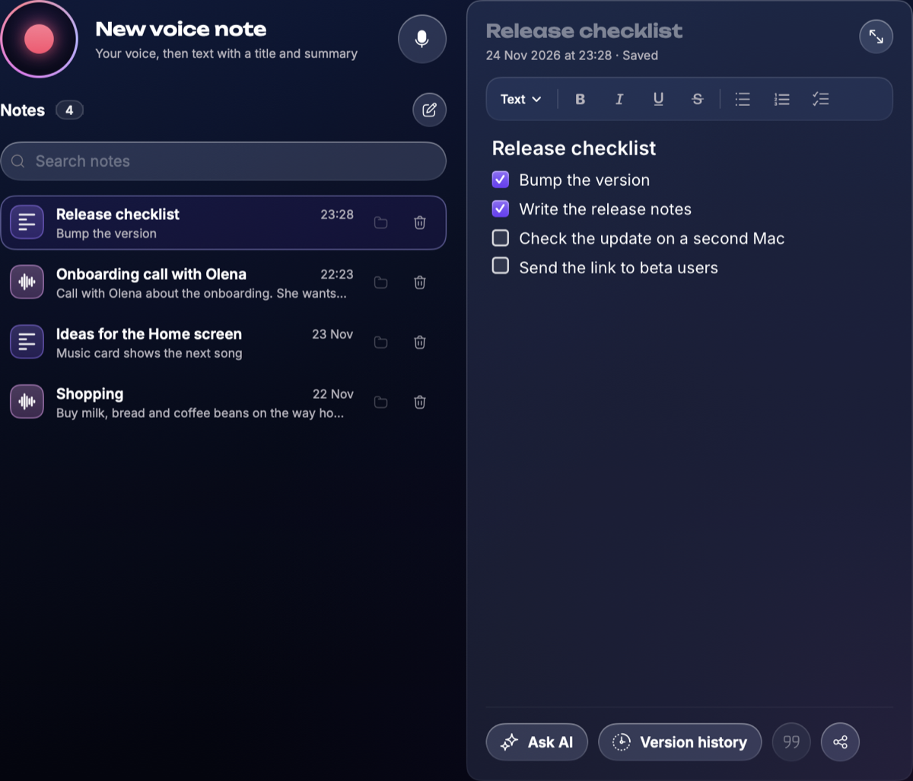

<p align="center">
  
</p>

<h1 align="center">Vela</h1>

<p align="center">
  <b>Your Mac's notch becomes a small control center.</b><br>
  Focus timer, music, tasks, notes, meetings and an AI assistant, one move of the mouse away.
</p>

<p align="center">
  <a href="https://github.com/wh1tehorse/vela-releases/releases/latest/download/Vela.zip"><b>⬇ Download Vela</b></a>
  &nbsp;·&nbsp;
  <a href="https://github.com/wh1tehorse/vela-releases/releases/latest">What's new</a>
  &nbsp;·&nbsp;
  macOS 14+ · Apple silicon
</p>

---

## Install

**The quick way.** Open Terminal and paste:

```bash
curl -fsSL https://github.com/wh1tehorse/vela-releases/releases/latest/download/install.sh | bash
```

It downloads Vela, puts it in Applications and opens it. Run it again any time to reinstall.

**By hand.** Download [Vela.zip](https://github.com/wh1tehorse/vela-releases/releases/latest/download/Vela.zip), open it and drag Vela to Applications. The first time, macOS says it can't check Vela: open **System Settings → Privacy & Security**, scroll down and click **Open Anyway**.

After that, Vela updates itself.

---

## What it does

Move the mouse to the notch and Vela opens. Move away and it's gone.

### ⏱ Focus



A Pomodoro timer on Home. Pick a task from Jira, ClickUp, Asana or Notion and Vela tracks the time on it. It can block the sites and apps you choose while you focus, play your focus music, and remind you to rest your eyes every 20 minutes.

### ✨ AI assistant



Ask anything by voice (**⌥ Space**) or in the notch. It sets reminders, writes notes, reads your calendar and tasks, searches the web, and works with files you allow it to. It asks before it sends, runs or deletes anything.



Keep **projects** with instructions, files and folders: every chat in a project knows them. Switch between Gemini, Claude and ChatGPT in the middle of a chat.

### 📝 Anywhere you type


Select text in any app and press **⌃⌥G**: fix, translate, shorten, change the tone, or ask the AI about it. **Dictation** (⌃⌥D) types what you say where the cursor is. Make your own commands too.

### 🗒 Notes and recordings



Write notes or record a voice note: Vela turns it into text with a title and a summary. Record calls and get a summary with decisions and tasks.

### 🎙 Meetings


**Teleprompter**: your script scrolls over the screen while you record or present. Viewers and recordings don't see it.


**Meeting helper**: forgot a price or how a feature works mid-call? One key shows a short hint from your notes. Speech is recognized on your Mac, and nobody on the call sees it.

### 🧩 And more

- **Music**: YouTube Music, Apple Music, Spotify or a folder, with the song by the notch.
- **Calendar**: today's meetings and one click to join.
- **Slack**: a nudge about messages you haven't answered.
- **Shelf**: clipboard history, files and new screenshots at hand. Screenshots you can draw on.
- **Paste queue**: copy several things, paste them one by one (**⌘E**).
- **Window layouts**: save how your windows are arranged and bring them back with one key.
- **Language practice**: translate into your language and get a short daily quiz from your own mistakes.
- **Telegram bot**: talk to Vela from your phone, by text or voice.
- **Coding agents**: see Claude Code, Codex and Gemini CLI sessions on Home and answer their questions from the notch.

Turn off what you don't use: it disappears everywhere and stops running.

---

## AI: bring your own key

Vela works with **Gemini**, **Claude** and **ChatGPT**. One is enough.

**Gemini is free:** sign in at [aistudio.google.com](https://aistudio.google.com), create an API key and paste it into Vela. No card needed. Everything else in Vela works without any AI key.

## Privacy

- Your API keys stay in your Mac's Keychain.
- Notes, recordings and settings stay on your Mac. If you connect the Telegram bot, it gets only what it needs to answer you there.
- AI requests go only to the AI you chose, and only when you use it.
- Anonymous usage stats help improve Vela. Turn them off in the intro or in Settings → About.

---

## Questions

**Which Macs?** Apple silicon (M1 or newer) with macOS 14 Sonoma or newer.

**Is there a license key?** Vela asks for one at the first start. A free key is one click away from that screen.

**How do I update?** Vela checks for updates itself and shows a card when a new version is ready.

**How do I remove it?** Quit Vela from the menu bar and move it from Applications to the Trash. Your data lives in `~/Library/Application Support/Vela` and `~/Documents/Vela`, if you want those gone too.

**Found a bug or have an idea?** Press **Problem? Share!** in Vela.
